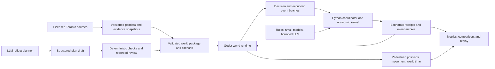

# System architecture

## Status and product boundary

This is the proposed architecture for a Toronto-first 3D pedestrian simulation. None of the world engine, bridge, durable run store, infrastructure planner, or connected UI described here is implemented yet. The current implementation is a Python economic prototype; see [integration status](integration.md).

The product should open on a recognizable Toronto 3D context, then focus on active areas where geography, routes, pedestrians, services, and outcomes are modeled in detail. The first planner demonstration may stage the school-meal proposal, but schools do not define the city or the simulation clock.

## Caller experience

An analyst loads a Toronto snapshot, selects a scenario, requests a rollout proposal, reviews the validated plan, runs a baseline and treatment, compares outcomes, and replays the result. Visible and headless runs use the same world and economic rules.

The following calls are sketches; they do not exist in the repository:

```text
sim6ix world inspect toronto-snapshot
sim6ix plan propose school-meals --horizon 10y
sim6ix plan validate plan.json
sim6ix run scenario.json --seed 17 --mode visible
sim6ix compare runs/base runs/rollout --by area,income
sim6ix replay runs/rollout
```

Plan drafts are not runnable until deterministic checks pass and the review record is attached. A run pins its map, population, policy, agent policy, model configuration, and code versions.

## State ownership and flow



Godot is the proposed authority for world time, positions, routes, physical activity, vehicles, and scene occupancy. Python remains the sole authority for cash, food lots, reservations, purchases, operating costs, household accounts, policy budgets, and economic response state. The Python coordinator is the sole run-archive writer. The renderer never settles purchases or advances policy capacity on its own.

| State | Sole writer | Boundary to the other side |
| --- | --- | --- |
| World clock, pedestrian and vehicle positions, active paths, physical activities | Godot 4 .NET runtime | Timestamped event batches and observations |
| Cash, food, reservations, transactions, public costs, modeled response variables | Python economic worker using the existing kernel | Accepted or rejected receipts and read-only projections |
| Scenario and approved rollout | Python study coordinator | Immutable, versioned package loaded by Godot |
| Planner draft | Planner adapter, then deterministic validator | Only reviewed, approved schedules can enter a run |
| Run archive | Python coordinator | Ordered world log, economic log, checksums, and checkpoints |

A bridge message carries a run ID, simulation second, world and economic revisions, and idempotency key. Godot pauses at an economic barrier until Python returns a receipt. A duplicate command returns its recorded receipt. Render frame rate and interpolation never change simulated state.

## Pedestrian decisions

People are embodied pedestrian agents; a household remains the owner of money and pantry state. A person may walk, attend a service, shop under a household mandate, or wait. The Python side creates a finite set of legal intents from the current observation. Rules handle routine decisions; small models or a fixed, budgeted LLM panel can select among those options. An LLM response cannot spend money, create food, move a person off-network, or invent a destination.

The study fixes which agents receive model calls before the run. Camera location does not affect selection. Invalid, late, unavailable, or unaffordable responses use a recorded deterministic fallback. The gateway receives no unrestricted database tools or credentials from the world process.

## Rollout planning and activation

The infrastructure planner works on a slower policy timescale than pedestrian movement. It receives a frozen map and evidence snapshot, selected solution IDs, available funds, current capacity, constraints, and a planning horizon. It returns a structured draft with candidate sites, dependencies, staffing or equipment needs, cost estimates or explicit unknowns, stage windows, capacity ramps, risks, source IDs, and stop conditions.

A deterministic validator checks source references, units, site eligibility, costs, dependencies, timing, and capacity. Review and approval are recorded against the plan hash. During a run, the world can show a planned stage, but Python checks prerequisites and funds and commits the activation before the stage becomes operational or changes economic capacity. Rejected, delayed, reduced, and canceled stages remain visible in the event history.

## Proposed technology map

| Component | Proposed technology | Current status |
| --- | --- | --- |
| Toronto world, navigation, pedestrians, visible and headless stepping | Godot 4 .NET with C# | Not present; lead candidate pending a vertical-slice check |
| Economic and policy kernel | Existing Python 3.10+ packages | Implemented as a headless, limited prototype |
| World/economy bridge and local commands | Python facade; private local FastAPI/WebSocket transport is a candidate | Not implemented |
| Resident decision policies | Python rules first; optional small model and bounded LLM adapter | Rules exist for household choices; pedestrian policies do not |
| Infrastructure planner | Python planner boundary with structured LLM output and deterministic validator | Not implemented |
| Local archive and replay | SQLite plus immutable hashed exports | Terminal exports exist; durable live-run storage does not |
| Toronto data ingestion | Python geospatial pipeline; library choice follows source audit | Not implemented; source layers are not ingested |
| Browser delivery | Re-evaluate Three.js only if browser access is a requirement | Earlier choice is superseded as default |

This is the proposed stack, not an implemented stack. Python keeps the existing economic research code; Godot is the lead 3D runtime because movement and world time are core simulation behavior. A visible/headless vertical slice must test the bridge and replay before the engine choice is final. If browser delivery is required, compare it directly before building the city scene. The exact GIS libraries, LLM provider, and small-model runtime remain open.

## Time, replay, and persistence

Godot advances logical simulation time to the next decision or physical event boundary, not once per rendered frame. Store integer seconds against a UTC scenario epoch and use `America/Toronto` for schedules and display. School calendars are one input among many local schedules; the clock spans the scenario horizon.

Seed independent random streams by resident or household, day, decision opportunity, and purpose. A change in policy-dependent event counts must not shift unrelated weather or income draws. Save algorithm versions and counters.

For a local run, use one Python archive writer and transactional SQLite records for metadata, world events, economic events, decision receipts, planner approvals, and checkpoint pointers. Keep source data and exports immutable with content hashes. A checkpoint includes both world and economic revisions, the pending queue, random counters, source references, and budget reservations.

Replay makes no model calls. It uses recorded decisions, bridge receipts, events, and pinned versions. A new live-model run gets a new run ID. Compare separate world and economic hashes; exclude camera position, cosmetic animation, and frame rate.

## Safety, failure, and acceptance

| Failure | Required behavior |
| --- | --- |
| Stale revision or invalid bridge message | Reject without partial state change |
| Economic invariant failure | Stop the run and mark affected results invalid |
| Planner source, geography, cost, or dependency failure | Reject or request revision; never activate from text alone |
| Model timeout, refusal, invalid intent, or budget exhaustion | Record the reason and use the configured rule fallback |
| Runtime or browser/client disconnect | Preserve committed state and resume from a compatible checkpoint |
| Partial export or unsupported replay version | Reject downstream use with an actionable diagnostic |

The first technical gate is one synthetic resident moving on a Toronto pedestrian graph in both visible and headless Godot runs, submitting one legal economic action, receiving the same Python receipt, and replaying to matching hashes. Establish performance targets only after Toronto data, active-area scale, and the runtime are measured.
