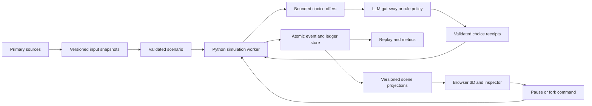

# System architecture

## Caller experience and proposed interfaces

Implementation status: `sim/core` owns economic transitions; `sim/district` supplies frozen synthetic inputs and a regression baseline; `sim/policies`, `sim/logistics`, `sim/behavior`, and `sim/experiments` supply the selected mechanisms. `sim/integration` adapts them into one runnable district and terminal exports. The package layout and service interfaces later in this document remain the target design. API, durable storage, and provider transport have not been implemented or assigned to the frontend owner. See [integration status](integration.md).

An analyst creates a scenario, runs a baseline, forks a treatment, compares results, and opens a replay. That is the public interface. The package hides scheduling, settlement, provider calls, persistence, and projection details.

The following is a design sketch. These commands and Python functions do not exist in the current repository.

```text
sim6ix validate scenarios/district.json
sim6ix run scenarios/district.json --days 30 --seed 17 --out runs/base-17
sim6ix experiment studies/groceries.json --out runs/groceries-study
sim6ix replay runs/base-17
```

```python
scenario = Scenario.read("scenarios/district.json")
runner = Simulator.open("runs")
baseline = runner.run(scenario, days=30, seed=17)
treatment = runner.run(scenario.with_policy(grocery_policy), days=30, seed=17)
difference = compare(baseline, treatment, group_by=GroupBy.INCOME)
view = replay(treatment, at_second=270000)
```

`Scenario.read` validates and freezes inputs. `run` returns a durable result handle. `with_policy` creates a new configuration. `compare` returns a paired-run difference and rejects incompatible units, populations, or baselines. An experiment compares replicated run sets to estimate uncertainty. `replay` produces a read-only view.

## Authority and data flow



One worker exclusively writes one run. A scene, chart, agent gateway, or analysis notebook cannot mutate the world. Multiple users inspect the same run through read-only projections. Policy edits fork at a committed boundary.

The worker owns cash, inventory, reservations, clock, mobility schedules, decisions, and policy activation. The renderer owns meshes, camera, visual interpolation, and selection. The gateway owns provider transport and charge reservations. Neither is an alternative economic state owner.

## Proposed package boundaries

| Proposed location | Knowledge it owns | Allowed callers |
| --- | --- | --- |
| `packages/sim6ix/scenario.py` | Units, catalog, source registry, scenario validation | Public API and data tools |
| `packages/sim6ix/kernel.py` | Clock, event queue, ordered transitions, run lifecycle | Public API and service |
| `packages/sim6ix/economy.py` | Accounts, food lots, reservations, purchases, processing, school allocation | Kernel only |
| `packages/sim6ix/mobility.py` | Feasible network routes, journey schedules, carrier constraints | Kernel and option generation |
| `packages/sim6ix/agents.py` | Household observations, choice policies, bounded memory, receipts | Kernel only |
| `packages/sim6ix/store.py` | Journal transactions, checkpoints, outbox, recovery | Kernel and read-only export |
| `packages/sim6ix/experiments.py` | Replications, comparisons, calibration, uncertainty | CLI and analysis tools |
| `services/api/` | Authenticated commands, run status, projections, exports | Browser and approved clients |
| `apps/web/` | Three.js scene, inspector, charts, accessibility controls | Users |
| `tools/data/` | Raw acquisition, transforms, geographic reconciliation | Dataset maintainers |

Export a small public API from `sim6ix`. Enforce import boundaries during implementation. Do not create repositories or services for individual households. A store purchase must remain traceable through the kernel, settlement, and persistence without a chain of forwarding wrappers.

Start with ordinary typed records and indexed tables. Add NumPy, Arrow, or another computational representation only when profiling justifies it. A wholesale entity-component framework would add a second modeling vocabulary before the domain is stable.

## Domain types and signatures

The sketch below is descriptive Python pseudocode. Constructors must parse and validate external data. Type annotations alone do not enforce state-dependent invariants.

```python
@dataclass(frozen=True)
class FoodLot:
	lot_id: LotId
	product_id: ProductId
	owner: ActorId
	custody: AtPlace | InJourney
	grams: NonnegativeGrams
	unsafe_after: SimSecond
	parents: tuple[LotId, ...]

@dataclass(frozen=True)
class ChoiceOffer:
	decision_id: DecisionId
	household_id: HouseholdId
	revision: Revision
	known_facts: tuple[ObservedFact, ...]
	options: tuple[FeasibleOption, ...]

@dataclass(frozen=True)
class ChoiceReceipt:
	decision_id: DecisionId
	option_id: OptionId
	origin: ChoiceOrigin
	observation_hash: ContentHash

@dataclass(frozen=True)
class EventEnvelope:
	run_id: RunId
	sequence: int
	second: SimSecond
	kind: EventKind
	causes: tuple[EventId, ...]
	payload: DomainEvent

def observe(world: World, household: HouseholdId) -> ChoiceOffer:
	raise NotImplementedError

def settle(world: World, intents: tuple[Intent, ...]) -> Transition:
	raise NotImplementedError

def commit(transition: Transition, store: RunStore) -> CommitReceipt:
	raise NotImplementedError
```

`ChoiceOrigin` distinguishes rule, LLM, recorded, and fallback choices. `Intent` is a closed set of permitted actions. `DomainEvent` is a versioned tagged union covering every authoritative change. It includes reservation creation and release, cancellation, household consumption, purchases, transfers, processing, meals, journeys, expiry, policy activation, and decisions. A complete reducer reconstructs the state between checkpoints. Wire JSON and provider SDK objects remain behind parsers.

Indexes answer the actual queries: lots by custodian and expiry, balances by account, reservations by lot and household, schools by program, trips by arrival, and actors by area. Derived indexes can be rebuilt. They do not carry independently editable copies of inventory.

## Clock and transition ordering

Use integer seconds since a UTC scenario epoch. Store `America/Toronto` for schedules and display. Generate local school days and opening hours from the calendar, including daylight-saving changes. Do not assume every local day is exactly 86,400 seconds.

The scheduler orders by second, domain phase, recorded admission rank, and stable event ID. At each event time, process these phases in order:

1. Activate dated policy changes and external income, price, or weather inputs.
2. Apply expiry and storage failures.
3. Complete journeys and release or settle arrival reservations.
4. Produce observations and collect choices at any decision barrier.
5. Adjudicate choices, allocate resources, and start new journeys or processing.
6. Serve meals, consume household food, and record outcomes.

Metrics observe committed state. Events scheduled into a phase already completed move to the next valid second. Travel and processing have a duration of at least one second. These rules prevent zero-time loops and explain what happens when delivery and expiry coincide.

For contested resources, use a seeded allocation order keyed by the decision opportunity. Stable actor-ID ordering alone would repeatedly favor the same household. Response arrival order is also unsuitable.

Named random streams use household, day, decision-opportunity, and purpose keys. Policy-dependent event counts must not shift unrelated weather or income draws. Save algorithm versions and counters. Python documents state capture and separate generators, while cautioning about reproducibility across versions. [Python random](https://docs.python.org/3/library/random.html).

## A purchase traced through the system

At 08:00, household H17 observes three affordable baskets and chooses one. The kernel validates the choice against the current revision. Settlement reserves finite stock and a maximum payment and commits `DecisionRecorded`, `ReservationCreated`, and `TripStarted` together.

The browser receives the committed journey, its route, departure, and arrival time. It animates the resident along that route. It does not change stock or cash.

At 08:18, the authoritative arrival event settles the purchase or cancels it according to the reservation rule. The store loses the lot, the household gains custody, and balanced cash entries post in the same transition. A price change cannot charge more than the reservation permits without a new choice.

The inspector can open the choice, reservation, journey, lot lineage, and journal entries. A redrawn character or a closed browser leaves the result unchanged.

## Storage, restart, and replay

For local work, use SQLite with one run writer. Store run metadata, versioned events, journal entries, decision receipts, and checkpoint pointers in transactions. Keep immutable raw data and export files outside the database with content hashes. SQLite documents atomic commit behavior. [SQLite atomic commit](https://www.sqlite.org/atomiccommit.html).

Compute a transition against an isolated candidate state. Check invariants, commit the complete journal and projection outbox, then publish the new in-memory state. An error before commit exposes no partial purchase. A unique run-and-command ID returns the prior receipt on duplicate submission.

Checkpoints include accounts, lots, reservations, queue, random counters, pending decisions, source references, and budget reservations. After a crash, load the checkpoint and apply committed events. Reject incompatible versions instead of silently changing their interpretation.

Persist the provider request record and maximum charge reservation before dispatch. A crash after dispatch may leave its external outcome unknown. Do not automatically resubmit that request. Retain the conservative reservation, record fallback, and reconcile later. A database transaction cannot make an external provider call atomic.

Replay performs no provider calls. It reconstructs state from events and decisions using the pinned build. A fresh live LLM run gets a new run ID. A state hash covers economic state, queue, reservations, random counters, and policy state. It excludes camera, frame rate, and cosmetic animation.

Later shared deployment can use PostgreSQL transactions, constraints, and object storage. Parallelize independent worlds first. Do not introduce multi-writer settlement inside a world to increase throughput.

## Commands and scene protocol

Proposed commands are create run, pause, resume, cancel, and fork from checkpoint. Each carries a command ID and expected revision. Controls return accepted or rejected receipts. Expensive scenario changes do not edit an active experiment in place.

The projection stream carries run ID, schema version, sequence number, simulation second, checksum, and changed entities. A checkpoint endpoint supplies a full view. On a gap, unknown schema, or checksum mismatch, the client reloads a checkpoint. A slow client receives a replacement snapshot instead of an unbounded backlog.

FastAPI supports WebSocket endpoints. Resume, backpressure, and compatibility remain project responsibilities. [FastAPI WebSockets](https://fastapi.tiangolo.com/advanced/websockets/).

The scene derives building locations and route geometry from the same input transforms as the simulation. Confirm the source coordinate reference system, convert to metres, and use a local origin. Never route on a visually convenient street that the model does not contain.

Use instanced low-detail buildings and residents, pooled detailed characters near the camera, culling, and selective labels. Three.js documents `InstancedMesh` for repeated geometry. [Three.js InstancedMesh](https://threejs.org/docs/pages/InstancedMesh.html).

The target scene shows queues, store access, processing, vans, and drone paths. Decorative wandering can appear only if labeled cosmetic and excluded from economic metrics. An accessibility table presents the same balances and outcomes without requiring 3D navigation.

## Local and shared deployments

The local prototype runs one API service, one simulation worker, and one browser client. The rule-based simulator runs offline once inputs are available. Live LLM decisions require a server-held credential. Credentials and raw private survey data never enter browser assets.

For shared demonstrations, add authenticated run ownership, per-user budgets, a bounded job queue, isolated worker directories, TLS, and retention settings. A cancellation stops new requests, preserves receipts, and releases internal reservations according to the cancellation contract. It does not erase already incurred provider charges.

Store generated text as untrusted display data. Escape it in the UI. Do not allow agent text to become commands, script, or unrestricted retrieval instructions. Use synthetic IDs and aggregate public inputs in the first release.

## Failure behavior and performance targets

| Failure | Required behavior |
| --- | --- |
| Invalid scenario or mixed units | Refuse run creation with field-level errors |
| Conservation failure | Stop run, preserve diagnostic state, mark metrics invalid |
| Provider failure or budget exhaustion | Record deterministic fallback and continue |
| Browser disconnect | Continue headless work and restore a projection on reconnect |
| Worker crash | Restore committed state without duplicate settlement |
| Unsupported replay version | Refuse with the required build or migration path |
| Partial export | Omit completion marker and reject downstream analysis |

Proposed targets are a 1,000-household, 100-institution, 30-day rule-only run within 10 minutes and under 4 GB worker memory on a documented eight-core, 16 GB reference machine. Live provider latency is excluded and reported separately. Target at least 30 frames per second at 1080p with 100 detailed residents, 500 simpler instances, and 50 vehicles on specified hardware. Show committed events within one second at normal live playback and reconnect within five seconds on a local network.

These targets are unmeasured acceptance gates. If they fail, profile the actual queue, allocation, routing, or rendering work before changing the architecture. More LLM calls are not a scaling strategy.
