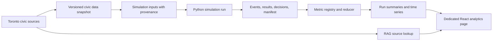

# Simulation Statistics Dashboard Implementation Plan

## Status and purpose

Status: the dedicated /dashboard page is implemented for the current bounded food-access traces. Its charts synchronize across tabs with the simulation page's committed trace playback and display the ingested input and retrieved source snapshot IDs. A Python-authoritative live service, reusable metric registry and reducer for verified completed-run exports, and reporting over broader runs remain planned. The 3D simulation page no longer hosts the statistics dashboard.

The dashboard tracks how the current food-access runs affect household access, retail and service operations, school meals, food support, and public costs. It is a full-page analytics workspace at /dashboard, reached from the simulation page. Selecting a site in the city can open the corresponding site record in the dashboard. The dashboard can select a trace and seek its playhead; it does not settle purchases or activate policies.

The broader reporting release should read completed runs. Current live synchronization follows the browser's playback position through committed events in a cached Python-generated trace. Live results from an ongoing Python-authoritative simulation still require a versioned event service.

## Current implementation boundary

The browser renders the frozen Toronto map and seeded pedestrian itineraries, and it replays Python-generated routes and committed food-access events with a read-only scenario dashboard. The broader Python economic prototype also writes terminal run exports, including events, results, decisions, logistics, and a manifest, but there is no ongoing live API. The architecture assigns world and economic state to Python and leaves the browser to render read-only snapshots and events. See the [implemented food-access scenario](../sim/interactables/README.md), [architecture](architecture.md#state-ownership-and-flow), [integration status](integration.md), and the current [browser app](../apps/web/src/App.tsx).

The civic-data pipeline's `dashboard.json` describes source coverage and location-derived inputs. It is distinct from simulation outcomes. Current location sources do not provide firm counts, prices, inventory, food-bank throughput, or school-meal reach; the pipeline represents these gaps as `null` with a reason. See [civic data retrieval](../sim/data/README.md#scope-and-evidence-limits). Keep the simulation report in a separate artifact such as `run_metrics.json`.

## Data flow



RAG provides source context and provenance. Numeric measures come from structured simulation records and declared input data. Retrieved text must not directly change a chart value or simulation state.

## Dashboard experience

The dashboard is a separate page, not a side panel beside the 3D environment. The city view links to /dashboard; selecting a food site can open its record there. The page loads one cached run at a time and keeps its run, population, and time playhead together. A BroadcastChannel synchronizes run selection and seeking with the simulation tab, which continues cached trace playback when it is in the background. This is live playback synchronization, not a live Python backend.

### Views

1. **Overview:** selected run and snapshot provenance, graph-first household food flow, service and purchase activity, modeled site inventory, recent interactions, and site activity.
2. **Interaction log:** searchable event records filtered by action, result, or site, with event-level timing and result details.
3. **Sites and services:** site inventory, operating status, throughput, denials, and recent activity, including retail, support, school, and emergency sites.
4. **Households:** searchable household records, modeled food outcomes, a single-run roll-up by selected group, and household event history.

The page controls scenario, population, and simulation time, synchronizing those controls with the open simulation tab. Event and site filters and household search support drill-down. The current page shows one run at a time; side-by-side run comparisons and uncertainty views are deferred. Avoid displaying measures the current trace cannot support. Charts describe modeled produce and service events; ingested source locations do not make modeled stock, hours, prices, or operations observed facts.

## Metric registry

Define and version metrics before chart implementation. Each registry entry should include:

```text
metric_id, label, definition, aggregation_version
unit, numerator, denominator, time_window
geography_scope, eligible_group, subgroup_dimensions
evidence_state, source_ids, known_limitations
```

Initial metrics:

| Metric | Initial definition | Caveat |
| --- | --- | --- |
| **Household-days with a modeled shortfall** | Household-days with modeled unmet need greater than zero divided by modeled household-days | Label the food categories included; the current economic fixture covers a produce component only. |
| **Modeled unmet food mass** | Sum of unmet grams divided by household-days or person-days, with the chosen denominator displayed | This is a model outcome, not observed hunger or complete diet adequacy. |
| **Retail fill rate** | Grams successfully purchased divided by grams requested across attempted baskets | Show failed and abandoned attempts separately; use consistent product and period coverage. |
| **Retail stockout exposure** | Stockout minutes for a site-product pair divided by open minutes for that pair | Requires reliable opening schedules and stock histories. |
| **Food-support service rate** | Aggregate requests served divided by aggregate requests received | Keep this separate from eligibility-based coverage; request data may be unavailable. |
| **School meal participation** | Meals served divided by eligible attending student-days | Participation, eligibility, attendance, and capacity are separate quantities. |
| **Food access time** | Median and 90th-percentile completed-trip time, including travel, queue, service, and return where modeled | Report unsuccessful trips and service denials separately. |
| **Household food spending** | Settled household food payments over the selected period | Show available budget/income separately. A food-spending-to-income ratio requires a compatible income measure. |
| **Retail activity** | Settled sales revenue and mass sold by site and food category | Report margin only when input, labor, and operating costs are modeled with evidence. |
| **Public program cost** | Public cash outlay by policy or program, with internal transfers reconciled | Do not double-count grants and downstream purchases as separate social resource costs. |

Every chart should show its unit, denominator, geography, period, and evidence status. Missing inputs remain `null` or are marked unavailable; they are never silently treated as zero.

## Run data contract

### Offline reporting first

For a completed run, read `events.json`, `results.json`, `decisions.json`, `logistics.json`, and `manifest.json`. Require a valid `COMPLETE` marker and manifest/file hashes before computing results. The existing exporter writes these artifacts and exposes `verify_export`; use that validation boundary before producing a dashboard summary. See [run export and verification](../sim/integration/export.py).

Generate a versioned `run_metrics.json` with run ID, scenario and policy IDs, seed, input snapshot IDs, code and metric versions, time buckets, aggregate measures, subgroup summaries, and source references. Keep row-level event data available for drill-down without sending the full event archive to the browser.

### Live reporting later

When the Python service is implemented, serve read-only snapshots and ordered event updates using the architecture's run ID, schema version, sequence, simulation time, and revision. The browser can update displayed summaries from those committed updates. It should request a fresh snapshot after a sequence gap and support replay from stored run data. Browser animation time and camera state must not determine a statistical result.

Candidate read boundary, pending backend design:

```text
GET /runs/{run_id}/summary
GET /runs/{run_id}/timeseries?metric_id=...&period=...
GET /runs/{run_id}/events?after_sequence=...
```

These are interface sketches, not implemented endpoints.

## Implementation sequence

1. **Create the dedicated dashboard page and navigation.** Implemented at /dashboard for the bounded browser traces; the simulation page links to it and no longer embeds the statistics panel.
2. **Build the current-run workflow.** Implemented scenario and population selection, a simulation-time playhead, summary measures, event search and filters, site/service inspection, household search, grouped roll-ups, and JSON export using the existing trace projection.
3. **Freeze the expanded metric set.** Agree on formulas, units, denominators, food categories, grouping variables, and explicit unavailable values before adding metrics beyond the current trace.
4. **Build the Python reporting reducer.** Derive summaries and time series from verified completed-run exports. Keep calculation code independent of rendering.
5. **Connect completed-run reports and evidence.** Validate COMPLETE markers and hashes, then expose provenance and limitations through the dedicated page.
6. **Extend live reporting after the API exists.** Browser trace playback and cross-tab synchronization are implemented. Subscribe to committed Python snapshots/events when the versioned service is available while preserving offline report and replay behavior. Run comparisons and uncertainty displays remain deferred.

The initial report may use the existing terminal fixture, but must identify its synthetic one-day scope and produce-only food coverage. The source-data candidate under `outputs/toronto-data/` is not a completed operational dataset and should not be presented as live Toronto business or service statistics.

## Acceptance gates

- Completed runs with missing markers or hash mismatches are rejected with a clear explanation.
- Reported totals reconcile with settled transactions and service events in the source run.
- The dedicated dashboard remains a single-run view until paired-run comparison is explicitly brought back into scope.
- Every displayed measure can be traced to its run, input snapshot, formula version, and source or scenario assumption.
- Unknown, estimated, announced, and illustrative values are distinguishable in the UI.
- Household roll-ups show group counts and per-household units and remain descriptive outputs from a single synthetic run.
- Charts have labeled units and accessible table equivalents; the dashboard remains usable on narrow screens.

## Related planning

- [Pedestrian interactables plan](pedestrian-interactables-plan.md)
- [Toronto data plan](data-plan.md)
- [Simulation model](simulation.md)
- [System architecture](architecture.md)
