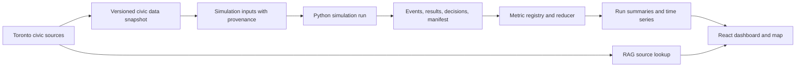

# Simulation Statistics Dashboard Implementation Plan

## Status and purpose

Status: proposed implementation plan for broader run statistics and a reusable metric pipeline. The browser already provides an event-driven dashboard for the bounded six-hour food-access scenario; this plan covers reporting beyond that scenario.

The dashboard will track how food-shortage scenarios affect household food access, retail and supply operations, school meals, food-support services, and public costs. It will provide a read-only view of simulation results and their evidence. It will not advance simulation time, settle purchases, or activate policies.

The first release should report completed runs. Live updates can use the same metric definitions after the Python-authoritative simulation service and its versioned event interface are available.

## Current implementation boundary

The browser renders the frozen Toronto map and seeded pedestrian itineraries, and it replays Python-generated routes and committed food-access events with a read-only scenario dashboard. The broader Python economic prototype also writes terminal run exports, including events, results, decisions, logistics, and a manifest, but there is no ongoing live API. The architecture assigns world and economic state to Python and leaves the browser to render read-only snapshots and events. See the [implemented food-access scenario](../sim/interactables/README.md), [architecture](architecture.md#state-ownership-and-flow), [integration status](integration.md), and the current [browser app](../apps/web/src/App.tsx).

The civic-data pipeline's `dashboard.json` describes source coverage and location-derived inputs. It is distinct from simulation outcomes. Current location sources do not provide firm counts, prices, inventory, food-bank throughput, or school-meal reach; the pipeline represents these gaps as `null` with a reason. See [civic data retrieval](../sim/data/README.md#scope-and-evidence-limits). Keep the simulation report in a separate artifact such as `run_metrics.json`.

## Data flow



RAG provides source context and provenance. Numeric measures come from structured simulation records and declared input data. Retrieved text must not directly change a chart value or simulation state.

## Dashboard experience

The dashboard should sit beside the existing 3D environment as a distinct statistics view. Selecting a site or area can link the map to its metrics; the map and dashboard should use the same run ID, simulation time, and geography.

### Views

1. **Overview:** run and policy selection; key outcomes over time; baseline-versus-policy comparison.
2. **Household access:** completed and failed food trips, total access time, travel and queue time, and household outcome distributions.
3. **Retail and supply:** stock, prices, deliveries, sales, and stockouts by site and modeled food category.
4. **Programs and schools:** service schedules and capacity, requests or eligible attendance, meals or baskets served, wait times, and unserved demand.
5. **Equity and evidence:** outcomes by area, income band, household size, and mobility; data freshness, missingness, evidence state, and source links.

The minimum controls are run/scenario, simulation period, geography, food category or service type, and household subgroup. Avoid displaying more metrics than the current model can support.

## Metric registry

Define and version metrics before chart implementation. Each registry entry should include:

```text
metric_id, label, definition, aggregation_version
unit, numerator, denominator, time_window
geography_scope, eligible_group, subgroup_dimensions
evidence_state, source_ids, known_limitations
```

Initial metrics:

| Metric | Initial definition | Caveat |
| --- | --- | --- |
| **Household-days with a modeled shortfall** | Household-days with modeled unmet need greater than zero divided by modeled household-days | Label the food categories included; the current economic fixture covers a produce component only. |
| **Modeled unmet food mass** | Sum of unmet grams divided by household-days or person-days, with the chosen denominator displayed | This is a model outcome, not observed hunger or complete diet adequacy. |
| **Retail fill rate** | Grams successfully purchased divided by grams requested across attempted baskets | Show failed and abandoned attempts separately; use consistent product and period coverage. |
| **Retail stockout exposure** | Stockout minutes for a site-product pair divided by open minutes for that pair | Requires reliable opening schedules and stock histories. |
| **Food-support service rate** | Aggregate requests served divided by aggregate requests received | Keep this separate from eligibility-based coverage; request data may be unavailable. |
| **School meal participation** | Meals served divided by eligible attending student-days | Participation, eligibility, attendance, and capacity are separate quantities. |
| **Food access time** | Median and 90th-percentile completed-trip time, including travel, queue, service, and return where modeled | Report unsuccessful trips and service denials separately. |
| **Household food spending** | Settled household food payments over the selected period | Show available budget/income separately. A food-spending-to-income ratio requires a compatible income measure. |
| **Retail activity** | Settled sales revenue and mass sold by site and food category | Report margin only when input, labor, and operating costs are modeled with evidence. |
| **Public program cost** | Public cash outlay by policy or program, with internal transfers reconciled | Do not double-count grants and downstream purchases as separate social resource costs. |

Every chart should show its unit, denominator, geography, period, and evidence status. Missing inputs remain `null` or are marked unavailable; they are never silently treated as zero.

## Run data contract

### Offline reporting first

For a completed run, read `events.json`, `results.json`, `decisions.json`, `logistics.json`, and `manifest.json`. Require a valid `COMPLETE` marker and manifest/file hashes before computing results. The existing exporter writes these artifacts and exposes `verify_export`; use that validation boundary before producing a dashboard summary. See [run export and verification](../sim/integration/export.py).

Generate a versioned `run_metrics.json` with run ID, scenario and policy IDs, seed, input snapshot IDs, code and metric versions, time buckets, aggregate measures, subgroup summaries, and source references. Keep row-level event data available for drill-down without sending the full event archive to the browser.

### Live reporting later

When the Python service is implemented, serve read-only snapshots and ordered event updates using the architecture's run ID, schema version, sequence, simulation time, and revision. The browser can update displayed summaries from those committed updates. It should request a fresh snapshot after a sequence gap and support replay from stored run data. Browser animation time and camera state must not determine a statistical result.

Candidate read boundary, pending backend design:

```text
GET /runs/{run_id}/summary
GET /runs/{run_id}/timeseries?metric_id=...&period=...
GET /runs/{run_id}/events?after_sequence=...
```

These are interface sketches, not implemented endpoints.

## Implementation sequence

1. **Freeze the first metric set.** Agree on formulas, units, denominators, food categories, grouping variables, and explicit unavailable values.
2. **Build a Python reporting reducer.** Derive summaries and time series from verified completed-run exports. Keep calculation code independent of rendering.
3. **Create the React statistics view.** Add Overview, Access, Supply, Programs, and Evidence views; use accessible tables for exact values and charts for trends and comparisons.
4. **Add paired run comparison.** Compare baseline and policy runs with matched seeds; show individual seed results and summary differences. Label variation across seeds as simulation variation, not real-world or parameter uncertainty.
5. **Connect shared map selections.** Filter the map and dashboard to the same site, area, and simulation period without changing the run.
6. **Integrate live events after the API exists.** Subscribe to committed Python snapshots/events while preserving offline report and replay behavior.

The initial report may use the existing terminal fixture, but must identify its synthetic one-day scope and produce-only food coverage. The source-data candidate under `outputs/toronto-data/` is not a completed operational dataset and should not be presented as live Toronto business or service statistics.

## Acceptance gates

- Completed runs with missing markers or hash mismatches are rejected with a clear explanation.
- Reported totals reconcile with settled transactions and service events in the source run.
- Baseline and treatment comparisons use compatible metric versions, periods, populations, and denominators.
- Every displayed measure can be traced to its run, input snapshot, formula version, and source or scenario assumption.
- Unknown, estimated, announced, and illustrative values are distinguishable in the UI.
- Subgroup views show sample counts and suppress interpretation when groups are too small for a meaningful comparison.
- Charts have labeled units and accessible table equivalents; the dashboard remains usable on narrow screens.

## Related planning

- [Pedestrian interactables plan](pedestrian-interactables-plan.md)
- [Toronto data plan](data-plan.md)
- [Simulation model](simulation.md)
- [System architecture](architecture.md)
