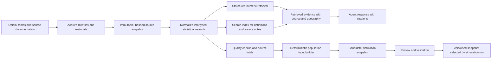

# Data plan

## Current map and next data gate

The browser already uses a frozen, attributed OpenStreetMap snapshot of downtown Toronto with a walking graph for the bounded food-access scenario. The next data milestone is to validate this baseline and expand it into a licensed, versioned Toronto world package with broader building massing, a usable street and pedestrian graph, stable feature IDs, and an explicit coordinate transform. Show lower-detail Toronto context outside the first active simulation area. Concentrate detailed destinations, pedestrian paths, and intervention sites inside that area. A geometry layer alone does not establish occupancy, rent, ownership, service capacity, or economic activity.

## Evidence states

Current spatial inputs: the browser and bounded food-access traces use a frozen, attributed OpenStreetMap snapshot of downtown Toronto and its walking graph. This is a limited scene and route input, not the complete versioned Toronto GIS world package described above. The connected district also uses the content-hashed illustrative snapshot under `sim/district/data`. Separately, `sim/data` supports a City GIS acquisition and retrieval flow that can create hashed candidate snapshots for supermarket, convenience-store, food-support-program, and education locations, plus a retrieval index and dashboard-ready source metrics. The first City GIS acquisition attempt could not establish outbound connections from this workspace, so a complete City GIS candidate snapshot is not available. These candidate locations do not replace or calibrate the illustrative district.

Each parameter carries one of four states: observed, announced, estimated, or illustrative. Unknown is a missing value with a reason, not a zero. A source can be verified while its input remains unsuitable for calibration because geography, timing, or definition does not match.

Public sources have been located and selected claims checked. Partner-held prices, costs, utilization, and behavior still require access. The initial runnable dataset must identify every illustrative substitute.

The initial `sim/data` schema and extraction path cover citywide locations only. Its canonical field map distinguishes named sites, service categories, school institution labels, coordinates, source IDs, and source dates. Source dates remain unknown when the API does not expose them; missing operator identities, prices, inventories, daily capacity, demand served, and school-meal reach remain null. See [`sim/data/README.md`](../sim/data/README.md) for the acquisition and retrieval commands.

## Priority data register

| Priority | Primary source | Required fields | Use and known gap |
| --- | --- | --- | --- |
| P0 | [Toronto 3D massing](https://open.toronto.ca/dataset/3d-massing/) | Building or tile IDs, geometry, height, coordinate system, licence, vintage | Primary 3D context. Inspect actual resource formats and coverage before choosing a renderer or converter. |
| P0 | [Toronto Centreline](https://ckan0.cf.opendata.inter.prod-toronto.ca/en/dataset/toronto-centreline-tcl) | Segment IDs, geometry, feature codes, mode eligibility, source vintage | Street foundation. Filter non-traversable features; it is not by itself a sidewalk or pedestrian graph. |
| P0 | Pedestrian links, crossings, barriers, and access | Stable link IDs, geometry, permitted modes, accessibility tags, source and quality flag | Build and validate the walkable graph for the active area. Identify gaps and synthetic links instead of silently routing across them. |
| P0 | [Toronto supermarket layer](https://gis.toronto.ca/arcgis/rest/services/cot_geospatial26/MapServer/4), [TDSB school directory](https://www.tdsb.on.ca/find-your/school) | Place IDs, names, coordinates, type, update date, status | Anchor the first active area and test feature-to-scene alignment. Verify current status and add non-supermarket food services separately. |
| P0 | Coordinate reference and map attribution | CRS, transform, local origin, licence, attribution, feature-ID mapping | Keep scene, route graph, services, and rollout sites spatially aligned and traceable to source records. |
| P1 | [TTC schedules](https://open.toronto.ca/dataset/ttc-routes-and-schedules/) | Stops, trips, stop times, service dates, accessibility | Add transit access where supported. Schedules do not establish observed reliability. Freeze feed validity. |
| P1 | [Census household total-income groups, Table 98-10-0055-01](https://www150.statcan.gc.ca/t1/tbl1/en/tv.action?pid=9810005501), [after-tax groups, Table 98-10-0056-01](https://www150.statcan.gc.ca/t1/tbl1/en/tv.action?pid=9810005601), [Toronto Neighbourhood Profiles](https://open.toronto.ca/dataset/neighbourhood-profiles/), [Toronto 2021 Census backgrounder](https://www.toronto.ca/wp-content/uploads/2022/07/9877-City-Planning-2021-Census-Backgrounder-Families-Hhlds-Marital-Status-Income.pdf) | Annual household income groups, household type, size, number of earners, age composition, geography, reference year | Primary controls for synthetic household income. Prefer annual after-tax household income groups for the first simulation attribute. Census income generally refers to 2020; Table 98-10-0056's household-characteristic cross-tabs are available for Toronto CMA/CMA parts, not neighbourhoods. Use City and neighbourhood controls only at the geography and detail actually published. |
| P1 | [Canadian Income Survey 2024, Table 11-10-0237-01](https://www150.statcan.gc.ca/t1/tbl1/en/tv.action?pid=1110023701) | Annual market, total, and after-tax income statistics by economic-family type and CMA | Freshness check for the Census household baseline. Its statistical units are economic families and persons not in economic families, so do not use it as a direct household distribution. |
| P1 | [CPI table 18-10-0004-01](https://www150.statcan.gc.ca/t1/tbl1/en/tv.action?pid=1810000401), [retail prices 18-10-0245-01](https://www150.statcan.gc.ca/t1/tbl1/en/tv.action?pid=1810024501), [Toronto cost of living](https://open.toronto.ca/dataset/cost-of-living-in-toronto-for-low-income-households/) | Geography, product, package size, month, price, household costs, vintage | Household-income controls can be acquired independently of map expansion. Price and cost inputs need matching geography, product definitions, and reference periods; supplement with dated local store audits. CPI rebasing changes dollar units, not the underlying income distribution or its economic context. |
| P1 | [Second Harvest reports](https://www.secondharvest.ca/about/reports) and school or food-hub operators | Sites, eligible input, rescued versus purchased mass, shifts, yields, menus, uptake, costs | Model service and rollout constraints. Request local operating records; national reports do not establish local daily capacity. |
| P1 | [Who's Hungry 2025](https://www.dailybread.ca/wp-content/uploads/2025/12/DB-WHR-2025-Final_Nov-3_reader.pdf) | Visits, survey methods, program geography | Demand context and hardship constraints; daily unmet requests and supply need partner records. |
| P2 | Consented local behavior or sentiment study | Sampling, question wording, geography, date, consent, response rate | Optional validation stream. Keep observations separate from synthetic agent state and generated dialogue. |
| P2 | [Transport Canada site guidance](https://tc.canada.ca/en/aviation/drone-safety/learn-rules-you-fly-your-drone/where-fly-your-drone) | Constraints, route-assessment references, date | Only needed for a drone delivery scenario. Eligibility checks are not route approvals or an operational airspace feed. |

Weather, energy, vehicle specifications, and emission factors are additional datasets for a drone or environmental study, not prerequisites for the first Toronto pedestrian scene. Use dated authoritative measurements and vehicle-specific tests when available. Otherwise expose downtime and energy as illustrative ranges and suppress unsupported emissions claims.

## Snapshot contract

Each raw or derived dataset records:

```text
dataset_id, publisher, source_url, resource_url
retrieved_at, published_at, reference_period_start, reference_period_end
geography_id, boundary_vintage, units, price_base_month
licence_url, attribution, raw_sha256, transform_revision
row_count, missingness, quality_flags, evidence_state
```

Unknown publication dates remain null. Do not use retrieval time as publication time. Current pages with unverified vintages stay outside a strict historical baseline until an archived or dated resource confirms availability.

Store raw files immutably, normalized tables separately, and a manifest that pins both. Never refresh an old run's source data in place. Corrections create a new snapshot and a new run.

Toronto's Open Government Licence permits reuse subject to its conditions. Track attribution and inspect each resource's terms. School, survey, mapping, and partner data can have different restrictions. [Toronto licence](https://open.toronto.ca/open-data-licence/).

## Acquisition and transformation workflow

1. Resolve the downloadable resource and its licence, rather than stopping at a catalog page.
2. Save the raw bytes and metadata. Calculate a content hash.
3. Validate fields, geography, units, dates, uniqueness, and source quality flags.
4. Normalize products and geographic IDs using explicit mapping tables.
5. Produce quality reports and a rejected-row file. Do not silently discard failures.
6. Build the scenario input snapshot and preserve all source lineage.
7. Compare aggregate outputs against source totals before making the snapshot selectable.

External APIs and files are validation boundaries. Keep transforms deterministic and rerunnable. A changed upstream schema must fail clearly. A refresh produces a candidate snapshot for review and does not alter published experiments.

Use checks for duplicate store or school IDs, implausible package mass, mixed dollars and cents, geometry outside the chosen area, prices outside their reference period, and missing input shares. A facility maximum is an upper bound, not an observed row repeated across every day.

## Household income evidence and model contract

The first income target is a household's **annual after-tax income group**, with its income reference year and dollar basis attached. This is a general household characteristic. It is not the household's cash balance at a point in the simulation. If a later model needs a numeric annual amount, generate a synthetic amount from the published group using a documented method and mark it as synthetic; do not represent it as observed household microdata.

Statistics Canada's 2021 Census Table 98-10-0056-01 reports household after-tax income groups for private households and supports breakdowns by household type, household size, age composition, and number of earners. Table 98-10-0055-01 provides household total-income groups. The Census income reference period is generally calendar year 2020, with income categories expressed in 2020 constant dollars. These tables provide aggregate counts, not records for individual Toronto households.

The 2021 Census Profile and Toronto Neighbourhood Profiles provide City/neighbourhood income and demographic controls. The City's 2021 backgrounder reports 1,160,890 households and a median total household income of $84,000 in 2020 dollars, as well as differences in household composition across Toronto. It also documents substantial pandemic benefit receipt in 2020. Treat the Census distribution as a dated baseline and label the pandemic-period reference year; CPI adjustment alone does not make it a measured current-year distribution. The City's profiles cover 158 neighbourhood geographies, but only publish certain measures at that level.

Table 98-10-0056-01's joint household-characteristic distributions use Toronto CMA and CMA-part geographies. They must not be described as Toronto City or neighbourhood cross-tabs. For City-level synthesis, use City-level household income groups and compatible City-level household composition margins. For neighbourhood analysis, add neighbourhood controls only where published. If margins do not identify the income-by-household-type relationship at the target geography, mark it as an assumption and evaluate plausible alternatives instead of implying the joint distribution is observed.

Statistics Canada's [2024 Canadian Income Survey Table 11-10-0237-01](https://www150.statcan.gc.ca/t1/tbl1/en/tv.action?pid=1110023701) is a more recent annual reference for Toronto CMA income, but its statistical units are economic families and persons not in economic families. Use it as a freshness or trend check; do not substitute it directly for private-household income records.

Keep income fields and time-varying cash-ledger fields separate in the simulation schema. Do not convert annual income to trip-time cash without a separate, explicit model of income timing, taxes, housing costs, and other commitments. Any support-program eligibility rule must also be explicit; a published income bracket does not automatically define eligibility.

## RAG-to-simulation pipeline

### Current implementation boundary

`sim/data` currently acquires civic location layers and builds a BM25-style lexical retrieval index over source notes and location records. It has no household-income dataset or configured LLM generation provider. Income retrieval and the income-to-simulation transformation below are planned additions, not implemented behavior. See [`sim/data/README.md`](../sim/data/README.md).

### Target flow



Use structured, dimension-filtered queries for numeric statistics (for example: geography, income concept, household type, household size, income group, and reference year). Use lexical or semantic retrieval for definitions, methodology, limitations, and source context. The agent can explain retrieved evidence and cite it; it must not invent aggregate values or silently write generated answers into the active simulation.

The deterministic population-input builder converts validated aggregate records into a candidate distribution or synthetic population. Its output retains the source dataset ID, extraction time, income concept, income reference year, currency base year, geography, household universe, income-group labels/counts, transformation revision, random seed, weights, and fitting diagnostics. Preserve source counts and the normalized table separately from derived household records.

Each candidate must pass checks before selection: source totals reconcile under the source's documented rounding rules; group labels, units, geography, and reference years are consistent; rounding, suppression, and missing cells are surfaced; derived proportions reproduce the selected controls within a documented tolerance; and seeded generation is reproducible. Publishing a new snapshot creates a new dataset/version and new simulation runs. Existing runs keep their original snapshot and provenance.

This pipeline can be developed alongside the agent layer. Define the snapshot and retrieval contract first so the agent can query a stable candidate dataset while the deterministic population builder is implemented and validated.

## Synthetic population

Create synthetic households and resident pedestrians that match available aggregate controls across household size, age bands, annual household income groups, tenure, and area. Attach homes and initial positions to eligible residential areas or clearly synthetic buildings. Give each simulated person a synthetic ID and only the schedule and attributes needed for the modeled activity. Use a documented fitting method such as iterative proportional fitting once compatible controls and seed distributions are obtained. Retain the source snapshot ID, seed, weights, convergence diagnostics, and residuals.

Aggregate controls do not identify the true joint distribution. Test several plausible household populations. If rent burden and income correlation are unknown, vary that correlation rather than inventing precise household budgets.

Reweight historic controls with dated newer evidence where justified. Do not inflate one historic median and describe the result as a measured 2026 income distribution. Keep demographic and price-year transformations separate.

Household IDs, names, appearance, and routines are synthetic. Do not reconstruct actual household addresses from food-bank or school records. Sensitive individual intake data are unnecessary for the first release.

## Local price and behavior measurements

Public averages cannot identify store-level prices, travel choices, or uptake. Prepare a small measurement protocol covering a fixed basket, date, store, package size, promotions, availability, and unit price. Record taxes where applicable and separate loyalty-only prices.

For behavior, request aggregate shopping frequency, program participation, travel modes, queue times, and changes after a price or service change. Consent-based surveys can ask what prevented uptake. Collect only fields needed for calibration and use an appropriate review process before a real study.

The first LLM evaluation panel uses synthetic cases. It does not need real names, chats, or private records. Real survey comments and generated comments have separate provenance and storage.

## Partner requests to prepare

| Partner category | Minimum aggregate request | Why it matters |
| --- | --- | --- |
| Municipal pilot team | Candidate sites, capital and operating budgets, supplier assumptions, planned dates | Feasibility and fiscal accounting |
| Processor | Daily input by source, rejects, output by recipe, shifts, storage, cost allocation | Usable capacity and delivered cost |
| School and food-hub operators | Active schools, days, uptake, menus, orders, prices, waste, delivery failures | Real service, procurement, and substitution |
| Food-bank network | Daily aggregate requests, served demand, unmet demand, stock, opening hours | Demand and capacity constraints |
| Carriers or drone operators | Payload, handling, downtime, maintenance, route and site costs, failed deliveries | Fair comparison against ground service |

These are proposed requests. No organization has been contacted and no private data access is implied.

## Tracking after the first snapshot

For an operational research workflow, ingest CPI and labor releases monthly, school provision by term and delivery day, store audits at a declared interval, and processor or hub logs at their actual reporting cadence. Keep both planned and actual dates.

A dashboard can show new source releases, stale inputs, quality failures, and baseline drift. Recalibration creates a new model version and keeps old comparisons reproducible. This document describes the future tracking system. No recurring automation has been scheduled.
